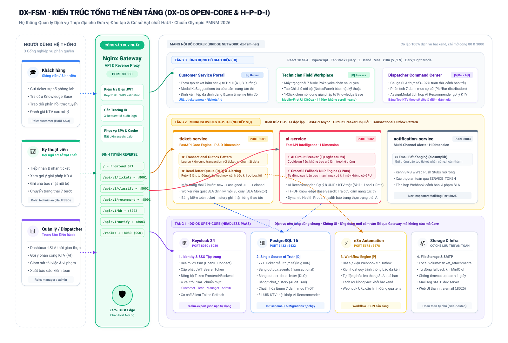

# DX-FSM – Field Service Management Platform

**Nền tảng Quản lý Dịch vụ Thực địa trên nền tảng DX-OS Open-Core**


## Mục lục

- [Giới thiệu](#giới-thiệu)
- [Bằng chứng đánh giá (100 điểm)](#bằng-chứng-đánh-giá-100-điểm)
- [Lệnh Live Demo 1 Chạm](#lệnh-live-demo-1-chạm)
- [Kiến trúc](#kiến-trúc)
- [Tính năng](#tính-năng)
- [Tech Stack](#tech-stack)
- [Cài đặt nhanh](#cài-đặt-nhanh)
- [Tài khoản demo](#tài-khoản-demo)
- [Cấu trúc dự án](#cấu-trúc-dự-án)
- [Tài liệu](#tài-liệu)
- [Đóng góp](#đóng-góp)
- [Giấy phép](#giấy-phép)

---

## Giới thiệu

DX-FSM là hệ thống quản lý dịch vụ thực địa, được xây dựng theo kiến trúc **DX-OS Open-Core 3 tầng**:

- **Tầng 1 – Open-Core (Headless):** Keycloak, nginx, PostgreSQL, MinIO, n8n
- **Tầng 2 – H-P-D-I:** Không gian Human, Process, Data, Intelligence
- **Tầng 3 – Ứng dụng:** React 18 SPA cho Customer, Technician, Manager

Bài toán: Doanh nghiệp cung cấp dịch vụ kỹ thuật (lắp đặt, bảo trì, sửa chữa) cần một nền tảng thống nhất thay thế Excel và tin nhắn rời rạc.

---

## Bằng chứng đánh giá (100 điểm)

Bảng đối soát minh chứng kỹ thuật phục vụ Hội đồng giám khảo chấm thi tuyển chọn HaUI và OLP PMNM 2026:

### I. Nhóm Điều kiện tiên quyết PoF (50 Điểm)

| STT | Tiêu chí đánh giá | Điểm | Tài liệu & Minh chứng | Lệnh kiểm tra nhanh |
|:---:|---|:---:|---|---|
| **1** | Kho mã nguồn & Lịch sử Git | 5 | [Repo GitHub công khai](https://github.com/truong-newbie/PMNM_2026_DX_FSM), web viewer hoạt động, 8 nhánh GitFlow | `git branch -a` |
| **2** | Giấy phép nguồn mở OSI | 10 | [LICENSE](LICENSE) (toàn văn 202 dòng Apache-2.0), 100% tệp có header SPDX | Quét 239/239 tệp mã |
| **3** | Quản lý phiên bản / Release | 5 | [RELEASE-NOTES-v1.3.0.md](RELEASE-NOTES-v1.3.0.md), thẻ tag `v1.3.0`, `v1.2.0`, `v1.1.0` | `git tag -l` |
| **4** | Build/install from source | 10 | [docs/deployment.md](docs/deployment.md), cấu hình pre-build `.env`, Docker Compose | `docker compose up -d --build` |
| **5** | Quản lý thư viện & Provenance | 10 | [DEPENDENCIES.md](DEPENDENCIES.md) (SBOM 200 dòng, ma trận license, không commit vendor/node_modules) | `npm ls`, `pip list` |
| **6** | Tài liệu & Bug tracker | 10 | [README.md](README.md), [CHANGELOG.md](CHANGELOG.md), [CONTRIBUTING.md](CONTRIBUTING.md), GitHub Issues/PRs | `docs/demo-script.md` |

### II. Nhóm Chất lượng sản phẩm & Trình diễn (50 Điểm)

| STT | Tiêu chí đánh giá | Điểm | Giải pháp kỹ thuật DX-FSM | Lệnh Live Demo |
|:---:|---|:---:|---|---|
| **7** | Đúng kiến trúc DX-OS & H-P-D-I | 10 | Tầng 1 Headless PaaS độc lập (SSO, Gateway, DB, Workflow); chứng minh chuỗi giá trị H-P-D-I | `make demo-core` |
| **8** | Mức độ hoàn thiện & ổn định | 10 | 77+ tickets thực tế HaUI (Migration 006), AI Circuit Breaker tự ngắt fallback < 2ms | `make demo-ai`<br>`make demo-sample-data` |
| **9** | Tính thân thiện & Giá trị thực tế | 10 | Giải quyết bài toán bảo trì cơ sở vật chất phòng lab/xưởng HaUI; phân quyền 3 cổng; VI/EN | Mở `http://localhost:3000` |
| **10** | Chất lượng kỹ thuật & Mở rộng | 10 | Transactional Outbox + DLQ, Zero hardcoded secrets, 324 tests tự động passed 100% | `make test` |
| **11** | Trình diễn & Tiềm năng cộng đồng | 10 | Kịch bản 10 phút demo ([docs/demo-script.md](docs/demo-script.md)), 12 slides ([docs/slides.md](docs/slides.md)), AI Recommender & KB | `make demo-recommender`<br>`make demo-kb` |

---

### Lệnh Live Demo 1 Chạm

Mỗi tính năng cốt lõi của đề thi đều có thể kiểm chứng ngay bằng **một lệnh Make** (in kết quả kiểm chứng kèm dấu `✓` trực quan):

```bash
make demo-core         # [Demo 1] Khởi chạy riêng Tầng 1 Open-Core (chứng minh Lõi độc lập với App)
make demo-ai           # [Demo 2] Test AI Classifier & Circuit Breaker tự ngắt (fallback NLP < 2ms)
make demo-recommender  # [Demo 3] Test AI Recommender gợi ý KTV bằng dữ liệu thật (8 UUIDs CSDL)
make demo-kb           # [Demo 4] Test Tra cứu Cẩm nang Kỹ thuật Knowledge Base (TF-IDF tức thì)
make demo-sample-data  # [Demo 5] Thống kê 77+ tickets dữ liệu mẫu thực tế tại các tòa nhà HaUI
```

---

## Kiến trúc



> 💡 **Bản tương tác & Tải ảnh 4K:** Mở file [docs/architecture-diagram.html](docs/architecture-diagram.html) trên trình duyệt để tải ảnh PNG siêu nét phục vụ slide thuyết trình và báo cáo.

```
┌─────────────────────────────────────────────────────────────┐
│                   TẦNG 3: ỨNG DỤNG NGHIỆP VỤ                │
│  Customer App │ KTV Mobile │ Manager Dashboard              │
│                    (React 18 SPA)                           │
├─────────────────────────────┬───────────────────────────────┤
│        TẦNG 2: H-P-D-I      │                               │
│  H: User/Profile            │ P: Ticket Workflow            │
│  D: Dashboard/KPI           │ I: AI Classify/Recommend      │
├─────────────────────────────┴───────────────────────────────┤
│                    TẦNG 1: DX-OS OPEN-CORE (HEADLESS)       │
│  Keycloak (SSO) │ nginx (Gateway) │ PostgreSQL (DB)         │
│  MinIO (S3 Files)        │ n8n (Workflow) │ Ollama (AI)     │
└─────────────────────────────────────────────────────────────┘
```

Xem chi tiết: [docs/architecture.md](docs/architecture.md)

---

## Tính năng

### Tầng 1 – Open-Core
- [x] **Identity/SSO** với Keycloak – JWT token, RBAC
- [x] **API Gateway** với nginx – routing, proxy
- [x] **Database** PostgreSQL – dữ liệu quan hệ, 7 danh mục sự cố
- [x] **File Storage** – MinIO S3 Object Storage (kèm cơ chế local volume fallback)
- [x] **Workflow Engine** với n8n – ticket intake → assign → process → close
- [x] **AI Service** – phân loại ticket tự động (Hybrid Rule-based + Ollama)

### Tầng 2 – H-P-D-I
- [x] **H – Human:** Quản lý user, profile, team
- [x] **P – Process:** Quy trình ticket có trạng thái, người tạo, người xử lý, timestamp
- [x] **D – Data:** Dashboard, KPI, thống kê real-time
- [x] **I – Intelligence:** AI phân loại ticket, Knowledge Base tìm kiếm giải pháp, gợi ý kỹ thuật viên

### Tầng 3 – Ứng dụng
- [x] **Customer Portal:** Tạo ticket, theo dõi trạng thái, gợi ý KB tức thì
- [x] **Technician Portal:** Nhận ticket, cập nhật tiến độ, upload ảnh, ghi chú nội bộ
- [x] **Manager Dashboard:** Tổng hợp KPI, phân công KTV với AI Recommender chấm điểm đa tiêu chí

---

## Tech Stack

| Thành phần | Công nghệ | Giấy phép |
|---|---|---|
| Identity/SSO | Keycloak 24 | Apache-2.0 |
| API Gateway | nginx | BSD-2-Clause |
| Database | PostgreSQL 16 | PostgreSQL |
| File Storage | MinIO Object Storage (S3 API) | AGPL-3.0 |
| Workflow | n8n | Elastic-2.0 / Sustainable |
| Backend API | FastAPI (Python 3.11) | MIT |
| AI Service | Hybrid (Rule-based Regex + TF-IDF + Heuristic + Ollama) | Apache-2.0 / MIT |
| Frontend | React 18 + Vite + TypeScript | MIT |
| Orchestration | Docker Compose | Apache-2.0 |

Xem chi tiết: [DEPENDENCIES.md](DEPENDENCIES.md)

---

## Cài đặt nhanh

### Yêu cầu

- Docker & Docker Compose v2
- Git
- 8GB RAM (tối thiểu 4GB)
- 20GB disk

### Các bước

```bash
# 1. Clone repository
git clone https://github.com/truong-newbie/PMNM_2026_DX_FSM.git
cd PMNM_2026_DX_FSM

# 2. Build và chạy toàn bộ
docker compose up -d --build

# 3. Đợi services khởi động (~2-3 phút)
docker compose ps

# 4. Truy cập các service
# Frontend:       http://localhost:3000
# API Gateway:    http://localhost/api/v1/tickets
# Keycloak:       http://localhost:8080/realms/dx-fsm
# n8n Workflow:   http://localhost:5678
```

### Build từ source

```bash
# Backend (FastAPI)
cd services/ticket-service
pip install -r requirements.txt
uvicorn app.main:app --reload --port 8001

# Frontend (React 18)
cd app
npm install
npm run build
npm run dev

# AI Service
cd services/ai-service
pip install -r requirements.txt
uvicorn app.main:app --reload --port 8002
```

---

## Tài khoản demo

| Role | Username | Password | Mô tả |
|---|---|---|---|
| Customer | `customer@haui.vn` | `customer123` | Tạo ticket, theo dõi trạng thái |
| Technician | `technician@haui.vn` | `tech123` | Nhận, xử lý, đóng ticket |
| Manager | `manager@haui.vn` | `manager123` | Dashboard, phân công kỹ thuật viên |
| Admin | `admin@haui.vn` | `admin123` | Quản trị Keycloak |

---

## Cấu trúc dự án

```
dx-fsm/
├── core/                    # Tầng 1: Open-Core (Headless)
│   ├── keycloak/            # SSO + RBAC
│   ├── nginx/               # API Gateway
│   ├── postgres/            # Database schema & migrations
│   ├── minio/               # S3 Object storage (active)
│   └── n8n/                 # Workflow engine
├── services/                # Tầng 2: Microservices
│   ├── ticket-service/      # Core API (FastAPI)
│   ├── ai-service/          # AI/ML (FastAPI + TF-IDF + Ollama)
│   └── notification-service/# Notifications
├── app/                     # Tầng 3: React 18 Frontend
├── docs/                    # Tài liệu kỹ thuật & Báo cáo
├── scripts/                 # Utility scripts & CI verification
└── docker-compose.yml       # Orchestration
```

---

## Tài liệu

| Tài liệu | Mô tả |
|---|---|
| [docs/architecture.md](docs/architecture.md) | Tổng quan kiến trúc DX-OS Open-Core 3 tầng |
| [docs/technical-report.md](docs/technical-report.md) | Báo cáo kỹ thuật chi tiết (Hội đồng OLP PMNM 2026) |
| [docs/deployment.md](docs/deployment.md) | Hướng dẫn cài đặt và vận hành Docker Compose |
| [docs/demo-script.md](docs/demo-script.md) | Kịch bản thuyết trình & demo 10 phút chuẩn HaUI OLP |
| [docs/api-specification.md](docs/api-specification.md) | Đặc tả kỹ thuật API RESTful |
| [docs/danh-gia-tieu-chi-cuoc-thi-2026.md](docs/danh-gia-tieu-chi-cuoc-thi-2026.md) | Báo cáo kiểm định 100 điểm & 10 câu hỏi chất vấn |
| [DEPENDENCIES.md](DEPENDENCIES.md) | SBOM & Phân tích tương thích giấy phép nguồn mở |
| [docs/SECURITY.md](docs/SECURITY.md) | Chính sách an toàn thông tin & Quản trị bí mật |

---

## Đóng góp

Xem [CONTRIBUTING.md](CONTRIBUTING.md) để biết quy trình đóng góp.

---

## Giấy phép

Dự án này được phân phối theo **Apache License 2.0**. Xem file [LICENSE](LICENSE) để biết chi tiết.
100% tệp mã nguồn tuân thủ SPDX License Header: `// SPDX-License-Identifier: Apache-2.0` hoặc `# SPDX-License-Identifier: Apache-2.0`.

---

**DX-FSM Team – OLP 2026 – HaUI**
