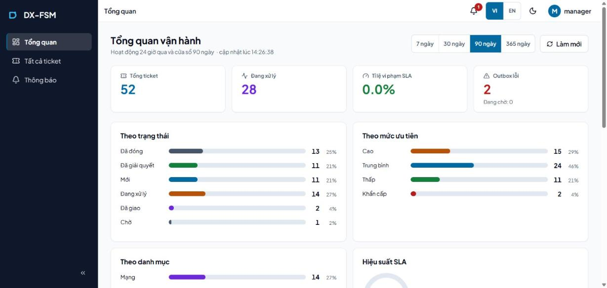
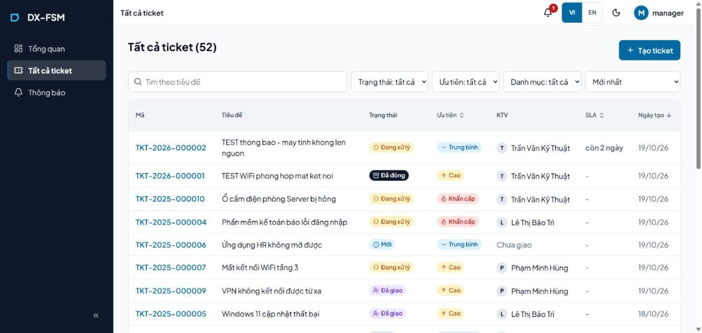
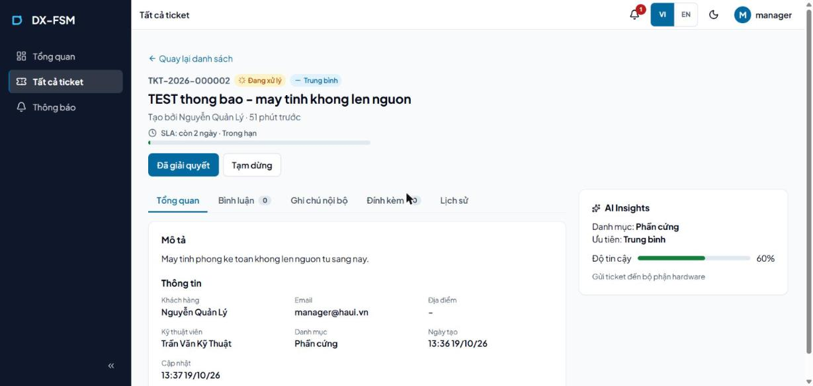
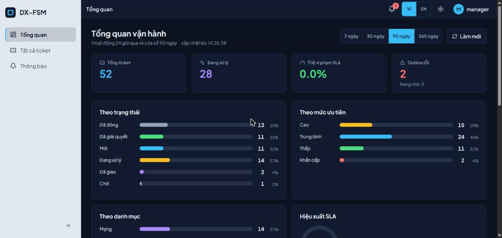
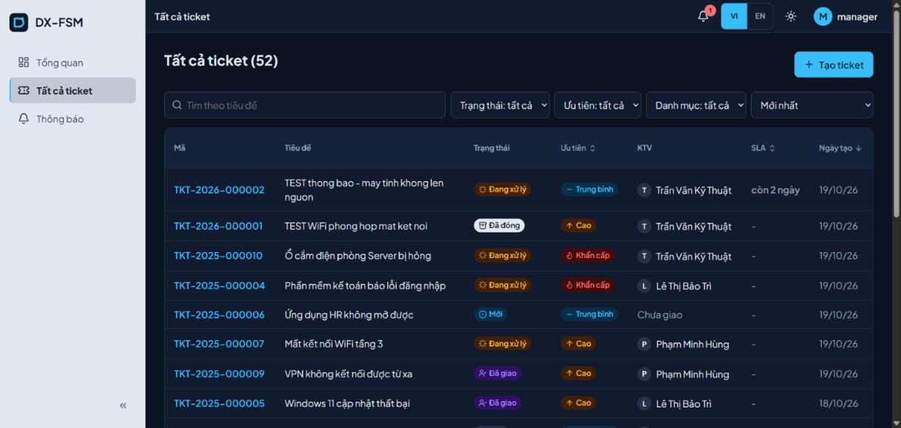
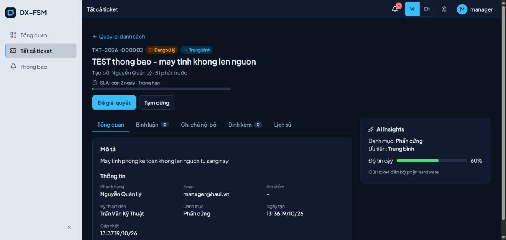

# DX-FSM Frontend

React 18 + Vite + TypeScript SPA cho nền tảng quản lý dịch vụ thực địa DX-FSM. Đăng nhập SSO qua Keycloak, gọi API qua gateway.

| Tổng quan | Danh sách ticket | Chi tiết ticket |
|---|---|---|
|  |  |  |
|  |  |  |

Mobile (375px): [tổng quan](../docs/screenshots/dashboard-light-mobile.jpg) · [tickets](../docs/screenshots/tickets-light-mobile.jpg) · [chi tiết](../docs/screenshots/ticket-detail-light-mobile.jpg)

## Chạy

### Cùng toàn bộ hệ thống (khuyến nghị)

```bash
docker compose up -d --build        # từ thư mục gốc repo
# mở http://localhost:3000
```

Container `app` là nginx phục vụ bản build production (fallback SPA, gzip, cache `assets/` 1 năm) và proxy `/api/` tới gateway.

> **Windows + WSL:** cổng `80` của `127.0.0.1` có thể bị nginx trong WSL (`wslrelay`) chiếm, nên `http://localhost/` không tới gateway của dự án. Hãy dùng `http://localhost:3000` (app tự proxy `/api` tới gateway) hoặc tắt nginx trong WSL.

### Chạy dev (hot reload)

```bash
cd app
npm ci
npm run dev                         # http://localhost:3000, proxy /api -> http://localhost:9180
```

Cần backend + Keycloak đang chạy (`docker compose up -d postgres keycloak gateway ticket-service ...`).

## Biến môi trường

Vite nhúng `VITE_*` lúc **build**, nên trong Docker chúng là build args (xem `app/Dockerfile`, `docker-compose.yml`). Mẫu ở `.env.example`:

| Biến | Mặc định | Ý nghĩa |
|---|---|---|
| `VITE_API_BASE_URL` | `/api/v1` | Gốc API (đi qua nginx của app → gateway) |
| `VITE_KEYCLOAK_URL` | `http://localhost:8080` | Keycloak |
| `VITE_KEYCLOAK_REALM` | `dx-fsm` | Realm |
| `VITE_KEYCLOAK_CLIENT_ID` | `dx-fsm-frontend` | Client public (PKCE S256) |
| `VITE_USE_MOCK` | _(trống)_ | `true`: dùng dữ liệu giả cho thông báo |

## Cấu trúc

```
src/
├── App.tsx, main.tsx          # router (lazy Dashboard/TicketDetail), providers, remount khi đổi ngôn ngữ
├── pages/                     # Login, Dashboard, Tickets, TicketCreate, TicketDetail, Notifications, NotFound
├── components/
│   ├── ui/                    # primitives dùng chung: Button, Badge, Card, Field, Modal, Tabs, Pagination, ...
│   ├── Tickets/, TicketDetail/, Dashboard/, Notes/, History/, Notifications/
│   └── Layout, Sidebar, TopBar, NotificationBell, LanguageSwitcher, AuthGuard, RoleGuard
├── hooks/                     # useRole, useMe, useDebounce, useNotifications
├── lib/                       # api (axios), auth (keycloak), ticket-meta, ticket-transitions, nav, sla, format, i18n, theme, ...
└── i18n/                      # vi.json, en.json (cùng bộ khoá)
```

## Quy ước design system

- **Token** nằm trong `src/index.css` (`:root` + `[data-theme='dark']`). Không viết mã màu hex ngoài khối đó; dùng `var(--surface)`, `var(--text)`, `var(--accent)`, `--space-*`, `--radius-*`, `--shadow-*`.
- **Thông tin không chỉ truyền bằng màu**: badge/trạng thái luôn kèm icon + chữ (`ticket-meta.ts` là nguồn duy nhất cho nhãn/tone/icon).
- Nút icon bắt buộc có `aria-label` (kiểu `Button` ép buộc). Touch target ≥ 44px.
- Mỗi trang có đúng một `h1`; đổi route thì focus vào `<main>` và cập nhật `document.title`.
- Theme mặc định theo hệ thống, người dùng đổi bằng nút trên top bar (lưu `localStorage`).
- Chỉ animate `transform`/`opacity`; tôn trọng `prefers-reduced-motion`.

## i18n (vi/en)

- Mặc định `vi`. Chuyển bằng nút **VI | EN** (lưu `localStorage`, đổi `<html lang>`).
- Dùng `t('khoá')` từ `src/lib/i18n.ts`. Khi đổi ngôn ngữ, `main.tsx` remount cây UI nên không cần hook ở từng component. **Không** giữ chuỗi dịch trong hằng số tính lúc import — dùng hàm/getter.
- Thêm chuỗi: thêm khoá vào **cả** `vi.json` và `en.json` (test kiểm tra hai file khớp khoá và `{{biến}}`).
- Kiểm tra chuỗi cứng còn sót: `python scripts/i18n-scan.py`.

## Kiểm thử và chất lượng

```bash
npm run lint            # ESLint, --max-warnings 0 (CI job lint-frontend)
npx tsc --noEmit        # typecheck (cũng chạy trong `npm run build`)
npm run test:unit       # vitest (CI job test-frontend)
npm run test:coverage   # coverage v8; ngưỡng lib/ >= 50%, pages/ >= 30% (thực tế ~94% / ~89%)
npm run build           # tsc + vite build
```

> Test cần Node ≥ 22.13/24 (jsdom 30). Dockerfile build dùng Node 20 chỉ để `vite build`.

## Phân quyền trong UI

| Role | Menu | Hành động ticket |
|---|---|---|
| customer | Ticket của tôi, Thông báo | Tạo ticket, bình luận, đóng/mở lại ticket của mình khi đã giải quyết |
| technician | Ticket của tôi, Thông báo | Nhận ticket mới; bắt đầu / tạm dừng / giải quyết ticket được giao |
| manager | Tổng quan, Tất cả ticket, Thông báo | Mọi chuyển trạng thái, phân công, huỷ, đóng |
| admin | như manager | như manager |

Ma trận hành động nằm ở `src/lib/ticket-transitions.ts` (có test) và khớp `STATUS_TRANSITIONS` ở backend; backend vẫn là nơi kiểm quyền cuối cùng.
