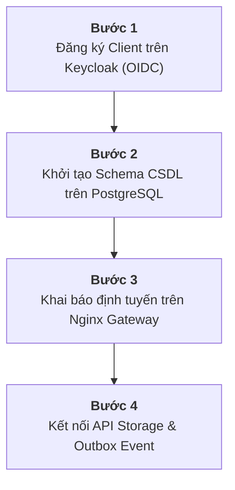

# Hướng Dẫn Phát Triển & Cắm Ứng Dụng Mới Trên Nền Tảng FixFlow Open-Core

> **Mục tiêu:** Chứng minh Tầng 1 của FixFlow là một **Nền tảng Lõi số độc lập (Headless PaaS)**, cung cấp các năng lực nền tảng qua giao diện lập trình mở (API Contracts), cho phép bất kỳ nhà phát triển bên thứ ba nào cắm thêm một ứng dụng nghiệp vụ mới vào hệ thống mà **hoàn toàn không phải sửa đổi mã nguồn của Lõi**.
>
> **Thời gian tích hợp ước tính:** Dưới 30 phút.

---

## 1. Năng lực Nền tảng Tầng 1 Cung cấp Sẵn (Open-Core Services)

Khi khởi chạy Tầng 1 bằng lệnh `make demo-core` (dựa trên [`docker-compose.core.yml`](../docker-compose.core.yml)), ứng dụng mới của bạn sẽ được thừa hưởng ngay lập tức 6 dịch vụ lõi:

| Dịch vụ Lõi | Công nghệ | Hợp đồng giao tiếp (Open API Contract) | Lợi ích cho ứng dụng mới |
|---|---|---|---|
| **Định danh & SSO** | Keycloak 24 | Chuẩn OpenID Connect (OIDC), OAuth 2.0 PKCE | Không phải viết module đăng nhập, tài khoản, quên mật khẩu |
| **API Gateway** | Nginx Gateway 1.27 | Same-Origin Routing trên Port 80 duy nhất | Không lo lỗi CORS, định tuyến thông suốt từ một tên miền |
| **Quản trị Dữ liệu** | PostgreSQL 16 | Relational DB + JSONB + GIN Index | Cơ sở dữ liệu chuẩn ACID với khả năng phân tách Schema |
| **Lưu trữ Đối tượng** | MinIO S3 | S3 RESTful API + Local Storage Fallback | Lưu trữ tệp ảnh, tài liệu đính kèm, sao lưu kho lạnh WORM |
| **Tự động hóa** | n8n Engine | Webhook Triggers & Workflow Automation | Kết nối quy trình tự động, gửi email/SMS thông báo |
| **Giao vận Truyền thông** | Notification Service | REST API (`/api/v1/notify`) định tuyến đa kênh | Đẩy email SMTP (MailHog), SMS, Push Notification tức thì |

---

## 2. Kịch bản Thực hành: Cắm Ứng dụng "Quản lý Thiết bị Kho Lab" (DX-Lab)

Giả sử khoa CNTT trường Đại học Công nghiệp Hà Nội muốn phát triển thêm ứng dụng **DX-Lab** (Quản lý mượn trả thiết bị thực hành và tài sản phòng máy) cắm vào Tầng 1 Open-Core đang chạy.

Quy trình tích hợp gồm **4 bước chuẩn hóa**:



---

### Bước 1: Đăng ký Ứng dụng trên Keycloak IAM
Ứng dụng mới không tự lưu mật khẩu người dùng mà sử dụng danh tính dùng chung của toàn trường thông qua Keycloak:

1. Đăng nhập trang quản trị Keycloak: `http://localhost:8080` (hoặc qua Gateway: `http://localhost/admin/`).
2. Chọn Realm: `dx-fsm`.
3. Vào mục **Clients** $\rightarrow$ Chọn **Create Client**:
   - **Client ID:** `dx-lab-app`
   - **Client Protocol:** `openid-connect`
   - **Client Authentication:** `Off` (đối với Web SPA / Mobile App) hoặc `On` (đối với Backend Server-to-Server).
4. Cấu hình URI chuyển hướng:
   - **Valid Redirect URIs:** `http://localhost/lab/*` (hoặc `https://<domain>/lab/*`)
   - **Web Origins:** `+` (kế thừa từ Redirect URI)
5. Thiết lập Role đặc thù của ứng dụng: Tạo role `lab_manager` và `lab_student` gắn vào Client.

*Kết quả:* Người dùng đã có thể dùng tài khoản trường đăng nhập vào DX-Lab thông qua JWT Token chuẩn OIDC.

---

### Bước 2: Tạo Schema CSDL Độc lập trên PostgreSQL
Để bảo đảm tính toàn vẹn và độc lập dữ liệu, ứng dụng mới không chèn chung bảng vào schema `public` của FixFlow mà sử dụng cơ chế phân tách không gian tên (**Schema-per-App**):

```sql
-- Đăng nhập vào PostgreSQL (localhost:5432) với tài khoản dxfsm
CREATE SCHEMA lab_inventory AUTHORIZATION dxfsm;

-- Tạo bảng quản lý thiết bị phòng Lab
CREATE TABLE lab_inventory.devices (
    id UUID PRIMARY KEY DEFAULT gen_random_uuid(),
    device_code VARCHAR(50) UNIQUE NOT NULL,
    device_name VARCHAR(255) NOT NULL,
    room_id VARCHAR(50) NOT NULL,
    status VARCHAR(50) DEFAULT 'available',
    specs JSONB, -- Lưu thông số kỹ thuật động bằng JSONB
    created_at TIMESTAMP WITH TIME ZONE DEFAULT CURRENT_TIMESTAMP
);

-- Tạo bảng mượn trả thiết bị
CREATE TABLE lab_inventory.borrow_records (
    id UUID PRIMARY KEY DEFAULT gen_random_uuid(),
    device_id UUID REFERENCES lab_inventory.devices(id),
    borrower_user_id VARCHAR(255) NOT NULL, -- Khớp với Keycloak Sub
    borrow_date DATE NOT NULL,
    return_deadline DATE NOT NULL,
    returned_at TIMESTAMP WITH TIME ZONE
);
```

*Kết quả:* Dữ liệu của ứng dụng mới hoàn toàn độc lập, không ảnh hưởng tới bảng `tickets` hiện có, nhưng vẫn dùng chung hệ thống sao lưu và chỉ mục tối ưu của PostgreSQL 16.

---

### Bước 3: Định tuyến Same-Origin trên Nginx Gateway
Để ứng dụng mới có thể gọi API mà không bị chặn CORS và chạy thông suốt trên cùng một tên miền Port 80, bổ sung khối `location` vào [`core/nginx/nginx.conf`](../core/nginx/nginx.conf):

```nginx
# Định tuyến cho ứng dụng mới DX-Lab
location /api/v1/lab/ {
    proxy_pass http://lab-service:8004/api/v1/;
    proxy_set_header Host $host;
    proxy_set_header X-Real-IP $remote_addr;
    proxy_set_header X-Forwarded-For $proxy_add_x_forwarded_for;
    proxy_set_header X-Forwarded-Proto $scheme;
    proxy_set_header X-Request-ID $request_id; # Bảo toàn truy vết tracing
}
```

Tải lại cấu hình Nginx trong **1 giây**:
```bash
docker compose exec gateway nginx -s reload
```

---

### Bước 4: Tận dụng MinIO S3 & Động cơ Luồng Công việc (Outbox/Webhook)
- **Lưu trữ ảnh tình trạng thiết bị:**  
  Ứng dụng DX-Lab kết nối tới MinIO qua biến môi trường S3 tiêu chuẩn:
  ```env
  S3_ENDPOINT=http://minio:9000
  S3_BUCKET=lab-attachments
  S3_ACCESS_KEY=dxfsm_minio
  S3_SECRET_KEY=dxfsm_minio_secret
  ```
- **Kích hoạt tự động hóa sự kiện khi thiết bị hỏng:**  
  Khi sinh viên báo thiết bị trong phòng Lab bị hỏng, ứng dụng DX-Lab chỉ cần đẩy một bản ghi vào bảng Outbox hoặc gọi Webhook của n8n:
  $$\text{DX-Lab Event} \longrightarrow \text{n8n Workflow} \longrightarrow \text{FixFlow Ticket Service (Tự động sinh vé sửa chữa FSM)}$$

---

## 3. Kết luận về Năng lực Kiến trúc

1. **Khả năng tái sử dụng (Reusability):** Tầng 1 hoạt động như một nền tảng điện toán đám mây thu nhỏ (Mini Sovereign Cloud), phục vụ song song cả Quản lý Sự cố Kỹ thuật (FixFlow), Quản lý Phòng thí nghiệm (DX-Lab), Quản lý Kho, v.v.
2. **Khả năng mở rộng (Extensibility):** Thêm ứng dụng mới chỉ tốn vài phút cấu hình khai báo, **không phải sửa một dòng mã nguồn nào của các dịch vụ lõi**.
3. **Tiết kiệm tài nguyên:** Thay vì mỗi ứng dụng phải tự dựng Keycloak, Postgres, Nginx riêng, tất cả đều hội tụ trên Tầng 1, giữ tổng dung lượng RAM toàn hệ thống ở mức tối ưu **< 2 GB**.

